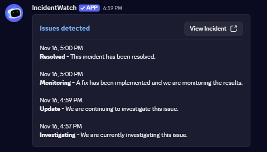

# 🚨 IncidentWatch

**Real-time incident monitoring for Discord.**

IncidentWatch polls DiscordStatus.com for reported incidents and delivers notifications directly to your configured Discord channel, keeping your community informed when something goes wrong.

[](https://discord.com/oauth2/authorize?client_id=1534996220710486229)

---

## ✨ Features

- 🚨 **Incident monitoring** — Receive notifications when DiscordStatus.com reports an incident.
- 🔔 **Discord notifications** — Deliver incident updates directly to a configured channel.
- ⚙️ **Simple configuration** — Configure IncidentWatch directly through Discord slash commands.

---

## 🔒 Proprietary Software

IncidentWatch is proprietary software.

The IncidentWatch source code and implementation are proprietary and may not be redistributed, modified, or used commercially without explicit permission.

---

## 📸 Example



---

## 🤖 Commands

IncidentWatch uses Discord slash commands for configuration and management.

### `/setincidentchannel`

Sets the Discord channel where incident notifications will be posted.

```text
/setincidentchannel
```

Select the desired channel when prompted.

---

## ⚙️ Getting Started

1. Add IncidentWatch to your Discord server.
2. Run `/setincidentchannel`.
3. Select the channel where incident notifications should be posted.

Once configured, IncidentWatch will automatically poll DiscordStatus.com for reported incidents and deliver updates to your configured channel.

---

## 🔔 Service Availability

IncidentWatch is designed to provide timely incident information, but notifications may occasionally be delayed or unavailable due to Discord, network connectivity, monitored services, or other external dependencies.

IncidentWatch should not be considered a replacement for official service-status sources.

---

## 🔐 Privacy

IncidentWatch is designed to process only the information necessary to provide its functionality.

For details about data collection, usage, and retention, see the [Privacy Policy](https://tw1st3dr0d3nt.github.io/status-watch/privacy.html).

---

## 📜 Legal

IncidentWatch is an independent, proprietary third-party Discord application and is not owned, operated, sponsored, or endorsed by Discord Inc.

Use of IncidentWatch is also subject to applicable Discord policies and terms.

**[Terms of Service](https://tw1st3dr0d3nt.github.io/status-watch/terms.html)** · **[Privacy Policy](https://tw1st3dr0d3nt.github.io/status-watch/privacy.html)**

---

<div align="center">

**🚨 IncidentWatch — Real-time incident monitoring for Discord.**

</div>
